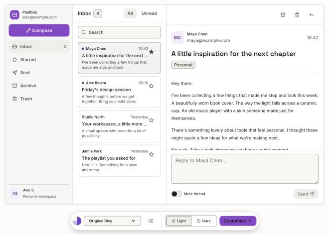
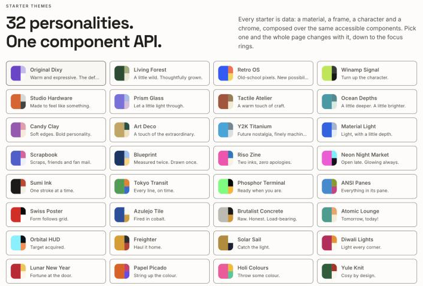

<p align="center">
  <a href="https://dixyui.com">
    
  </a>
</p>

<h1 align="center">Dixy UI</h1>

<p align="center">
  <strong>Components with character.</strong><br />
  Accessible React components on Base UI, with 38 starter themes that change the whole feel of your product.
</p>

<p align="center">
  <a href="https://www.npmjs.com/package/@dixy-ui/react"></a>
  <a href="./LICENSE"></a>
  <a href="https://github.com/akssmax/DixyUI/actions/workflows/ci.yml"></a>
  
</p>

<p align="center">
  <a href="https://dixyui.com/docs/installation"><strong>Get started</strong></a> ·
  <a href="https://dixyui.com/docs/components/button">Components</a> ·
  <a href="https://dixyui.com/#themes">Themes</a> ·
  <a href="https://dixyui.com/playground">Playground</a>
</p>

<br />

<picture>
  <source media="(prefers-color-scheme: dark)" srcset="./.github/assets/readme-hero-dark.png" />
  
</picture>

> [!NOTE]
> **Dixy UI is in public beta.** APIs may change between `0.x` releases, and every change is listed in each package's changelog. See [Known issues](#known-issues).

## Why Dixy

- **Accessible by default.** Behaviour comes from [Base UI](https://base-ui.com) and [React Aria](https://react-spectrum.adobe.com/react-aria/), covering focus management, keyboard support and ARIA. Every component is checked with axe in the test suite.
- **Themes, not just colours.** One `<Theme>` prop switches material, frame, typography and ornament. Pick from 38 starter themes or write your own with the theme authoring API.
- **Semantic tokens.** 39 OKLCH palette families with 12 light and 12 dark stops each. Components use semantic roles (surface, text, border, action, feedback), so dark mode and custom accents just work.
- **Motion with restraint.** Shared timings and easing, with optional springs through `@dixy-ui/react/motion`. Reduced motion is respected everywhere.
- **No build step for styles.** Plain CSS in cascade layers, so your styles always win. No Tailwind compiler required, but Tailwind v4 bindings are available if you want them.
- **Tree-shakeable.** Import only what you use. `Button` alone is about 17 KiB minified, and CI enforces size budgets.

## Installation

```sh
pnpm add @dixy-ui/react@beta
```

```sh
npm install @dixy-ui/react@beta
```

`react` and `react-dom` 19 are peer dependencies. `motion` 14 is optional.

## Usage

Import the stylesheet once, then wrap your app in `Theme`:

```tsx
import "@dixy-ui/react/styles.css";
import { Theme, Button, Field, TextField } from "@dixy-ui/react";

export function App() {
  return (
    <Theme appearance="light" accentColor="violet" radius="md">
      <Field.Root>
        <Field.Label>Project name</Field.Label>
        <TextField placeholder="Something worth making" />
        <Field.Description>Visible to your team.</Field.Description>
      </Field.Root>
      <Button>Create project</Button>
    </Theme>
  );
}
```

Read the [installation guide](https://dixyui.com/docs/installation) for SSR, overlays and framework notes.

## Themes



Each starter is a material, a frame, a character and a chrome, composed over the same components. Add one with two imports:

```sh
pnpm add @dixy-ui/themes@beta
```

```tsx
import { retroOSTheme } from "@dixy-ui/themes/retro-os";
import "@dixy-ui/themes/retro-os.css";

<Theme {...retroOSTheme}>
  <App />
</Theme>;
```

Every theme is a separate entry point, so you only ship the one you use. Try them all on the [landing page](https://dixyui.com/#themes), or design your own in the [playground](https://dixyui.com/playground).

## Components

96 components in ten groups. Browse them in the [docs](https://dixyui.com/docs/components/button).

| Group                   | Components                                                                                                                                                                                                                          |
| ----------------------- | ----------------------------------------------------------------------------------------------------------------------------------------------------------------------------------------------------------------------------------- |
| **Actions**             | Button, Button Group, Link, Toggle, Toggle Group                                                                                                                                                                                    |
| **Forms**               | Autocomplete, Checkbox, Checkbox Group, Color Picker, Combobox, Field, Fieldset, Form, Input Group, Native Select, Number Field, OTP Field, Password Field, Radio Group, Search Field, Select, Slider, Switch, Text Field, Textarea |
| **Date & time**         | Calendar, Date Field, Date Picker, Date Range Picker, Range Calendar, Time Field                                                                                                                                                    |
| **Navigation**          | Breadcrumbs, Command, Menubar, Navbar, Navigation Menu, Pagination, Sidebar, Tabs, Toolbar                                                                                                                                          |
| **Overlays**            | Alert Dialog, Context Menu, Dialog, Drawer, Menu, Popover, Preview Card, Tooltip                                                                                                                                                    |
| **Feedback**            | Alert, Empty State, Meter, Progress, Progress Circle, Skeleton, Spinner, Toast                                                                                                                                                      |
| **Data display**        | Avatar, Avatar Group, Badge, Card, Carousel, Chart, Chip, Data List, Data Table, Image, Item, Kbd, List Box, Table, Tag Group, User                                                                                                 |
| **Layout & disclosure** | Accordion, Aspect Ratio, Collapsible, Grid, Resizable Panels, Scroll Area, Scroll Shadow, Separator, Visually Hidden                                                                                                                |
| **Text & code**         | Blockquote, Code, Icon, Snippet, Typography                                                                                                                                                                                         |
| **AI**                  | Code Block, Conversation, Message, Prompt Input, Reasoning, Response, Shimmer & Loader, Sources, Suggestions, Tool                                                                                                                  |

## Packages

| Package                                | Description                                                                                        |
| -------------------------------------- | -------------------------------------------------------------------------------------------------- |
| [`@dixy-ui/react`](./packages/react)   | The components, the `Theme` provider and the stylesheet                                            |
| [`@dixy-ui/themes`](./packages/themes) | 38 optional starter themes and the theme authoring API                                             |
| [`@dixy-ui/tokens`](./packages/tokens) | Framework-independent colour, type, size, space and motion tokens as plain CSS, TS and Tailwind v4 |

## Supported environments

- **React** 19, with client or server rendering. Tested with TanStack Start and Vite SSR.
- **Browsers:** Chrome/Edge 117+, Safari 16.2+ and Firefox 121+. The styles use `oklch()`, `color-mix()`, `:has()`, container queries and subgrid. Some decorative glass blur needs Safari 18+ and falls back to a solid surface on older versions.
- **Accessibility:** the target is WCAG 2.2 AA. See [Known issues](#known-issues) for what has not been tested yet.

## Known issues

- Screen readers (VoiceOver, NVDA), Windows high-contrast mode, touch devices and 200%/400% zoom have not yet been tested systematically.
- Right-to-left layouts are only partly verified.
- Component and prop names may change before 1.0. Renames will be listed in the changelog.

Found something else? [Open an issue](https://github.com/akssmax/DixyUI/issues/new/choose).

## Community

- [GitHub Issues](https://github.com/akssmax/DixyUI/issues) for bugs and feature requests.
- [Security policy](./SECURITY.md) for reporting vulnerabilities privately.

## Contributing

Contributions are welcome. Read [CONTRIBUTING.md](./CONTRIBUTING.md) for local setup, checks, changesets and the sign-off requirement, and follow the [code of conduct](./CODE_OF_CONDUCT.md).

## License

[MIT](./LICENSE) © Akshay Saini
