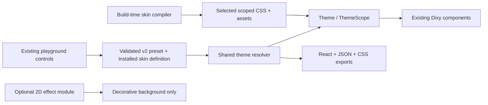

# Six 2D skins in the Dixy playground — implementation plan

Date: 2026-10-20  
Status: six skins, procedural artwork and creator/preview implementation delivered; verification and remaining release checks are recorded in SIX_THEME_COVERAGE.md.  
Scope: Living Forest, Retro OS, Winamp Signal, Studio Hardware, Prism Glass and Tactile Atelier, using the existing Dixy components and existing /playground route.  
Supersedes: the rendering, packaging and delivery recommendations in PERSONALIZATION_AND_SKINS_PLAN.md wherever they differ. That document remains the product rationale.  
Explicit decision: Three.js and React Three Fiber are dropped from this scope. Optional shaders are 2D enhancements, not component renderers.

## Implementation update — 2026-10-20

The six packs now exist in `packages/themes` and the existing playground. Overview, Player, Email and States use public Dixy components. Preset v2, migration, inheritance/portal scoping, per-skin drafts, bounded undo/redo, character controls, CSS/React/JSON exports and independent packed consumption are implemented. See [the implementation matrix](SIX_THEME_COVERAGE.md) for exact coverage and evidence.

Two implementation decisions refine this plan: the first visit to each skin uses its reference appearance (Signal/Prism dark), while subsequent visits restore its draft; direction/motion/effect reductions remain persistent. Forest initially used a generated WebP border; on 2026-10-21 it was replaced with procedural React/SVG geometry, live HTML content and opt-in animation at the user’s request. The five remaining skins received independent procedural renderers and detailed component recipes in the subsequent pass; see PROCEDURAL_SKINS.md. The shaders branch remains deferred; the six identities work as static 2D CSS.

P1–P4 have a working implementation. P0/P6 have source, automated, package and focused browser evidence; the full hardware/assistive-technology/framework release matrix remains open. P5's optional frosted toolbar exists with fallbacks but has not been accepted through device profiling. No pending benchmark is represented as a measured pass.

## 1. Intended outcome and boundaries

A person opens /playground, chooses one of six distinctive skins and immediately recognizes a different visual language across real working Dixy controls. They can tune the skin, inspect normal and exceptional states, open actual popups, browse the existing component gallery and export the same theme they are seeing.

Reuse the current Base UI, React Aria and native semantic ownership. There is one Button, Switch, Slider and so on, with shared behavior and skin-aware styling. Do not build six component trees, swap real controls for painted canvases, introduce another UI stack, change controlled/uncontrolled contracts, or rasterize labels into artwork.

Deliver complete usable static versions of all six skins first. CSS backdrop glass is a measured opt-in enhancement. A separate bounded 2D shader experiment can follow; its acceptance is independent of completing the six skins. No 3D engine, physics, live DOM-to-texture capture, audio playback service, community hosting service or arbitrary imported shader execution is part of this implementation.

The generated boards are direction references, not pixel-perfect implementation specifications. Preserve their materials, border vocabulary and personality while adapting details to usable controls, responsive layouts and measured costs.

## 2. Existing source and integration points

This plan was grounded in source inspection on 2026-10-20. File names below are current unless marked proposed.

| Existing source                                                          | Current role                                                                                      | Planned extension                                                                                                       |
| ------------------------------------------------------------------------ | ------------------------------------------------------------------------------------------------- | ----------------------------------------------------------------------------------------------------------------------- |
| apps/docs/src/routes/playground.tsx                                      | /playground route; validated theme search string; replace-history updates                         | Accept/migrate v2 presets; resolve selected skin; coordinate initial stylesheet and committed URL state.                |
| apps/docs/src/components/theme-playground.tsx                            | Overview, All components, Surfaces & borders, compact dock, More foundations, import/export/reset | Add skin selection, focused character controls, scene/state previews and matching exports inside the same workbench.    |
| apps/docs/src/lib/theme-playground.ts                                    | ThemePreset v1, starters, parsing, palette mapping and React export                               | Add a versioned normalized skin preset, explicit overrides, migrations and one resolved export/preview model.           |
| apps/docs/src/components/theme-component-gallery.tsx                     | Searchable categorized gallery with near-viewport lazy mounting and retry                         | Retain lazy behavior; render inherited skin defaults and show honest coverage.                                          |
| apps/docs/src/lib/theme-preview-catalogue.ts                             | Derives gallery entries and explicit initial values from component registry                       | Separate theme-inheriting preview values from component-page initial values.                                            |
| apps/docs/src/registry/components.ts and related registries              | Actual component contracts, controls, lazy examples and raw-source loaders                        | Declare which visual controls may inherit; preserve authored component-specific structure/behavior.                     |
| apps/docs/src/styles/theme-playground.css                                | Current preview-first workbench, dock and responsive dialog styling                               | Add compact skin strip, state scene and loading/error treatment without a second editor layout.                         |
| packages/react/src/theme/theme.tsx                                       | Theme, ThemeScope, context, expressive defaults and inherited reduction                           | Carry selected skin identity/defaults, explicit overrides and clearing through nested scopes and open portals.          |
| packages/react/src/utilities/component-visuals.ts                        | Shared DOM visual attributes and theme fallback                                                   | Resolve supported role defaults and expose stable part/skin hooks without replacing primitive behavior.                 |
| packages/react/src/components/button.tsx                                 | Button has its own visual/group fallback path                                                     | Align it with the documented skin precedence; retain group defaults, refs and render callbacks.                         |
| packages/react/src/components/content.tsx                                | Existing content families including Card                                                          | Reuse existing parts; add styling hooks only where the role inventory demonstrates a need.                              |
| packages/tokens/src/materials.ts, shapes.ts, personalities.ts, motion.ts | Canonical expressive contracts and existing conservative budgets                                  | Extend through authored contracts/generation; keep shape, material, personality, skin and preference concepts distinct. |
| scripts/generate-materials.mjs and packages/react/vite.config.ts         | Generated recipes and independently emitted optional CSS                                          | Preserve separation; introduce a separate skin generation/build pipeline.                                               |
| apps/docs/src/components/material-performance-lab.tsx                    | Explicit finite flat/static/backdrop comparison                                                   | Reuse measurement concepts and extend with selected-skin fixtures; do not run sampling automatically.                   |
| scripts/verify-package.mjs and fixtures/                                 | Independent packed consumer checks                                                                | Add skin imports, assets, SSR, optional enhancement and core-exclusion coverage.                                        |

Current important findings:

- Theme already supports material, shape, personality, effects, motion, radius, density and colors. ThemeScope already restores context in portals; extend it rather than inventing a second scope.
- The current serializable playground preset omits much of that expressive state. Adding UI controls without extending serialization would make previews, links and exports disagree.
- Gallery defaults are copied from component-control initial values. Button, Switch and Tabs examples also default material to matte and geometry to concrete values in their function parameters. Simply wrapping that gallery in a skin will leave some specimens looking unchanged.
- The existing preview Theme key changes only for explicit reset. Preserve that property: selecting a skin must not remount controls or erase typed text/selection.
- The existing route replaces its search value on every update. An expanded editor should avoid URL serialization/navigation on every drag frame.
- Optional material CSS already exists. A skin must not silently pull every other skin, a graphics engine or authoring tools into the core stylesheet or JS entry.

## 3. Chosen architecture

### 3.1 Layers and ownership



The consumer performs ordinary theme scoping and simple default resolution. It does not compile arbitrary theme CSS on every render. Full manifests, schema validators, SVG optimizers, source text, thumbnail sheets and editor history stay outside the component runtime.

### 3.2 Package decision

Introduce one proposed workspace package, packages/themes, named @dixy-ui/themes. It owns the six authored manifests, public compact skin definitions, generated independent stylesheets, selected assets and authoring exports. A second theme-tools package is unnecessary for the first delivery; split it later only if distribution or dependency boundaries justify it.

Proposed public entry layout:

```text
@dixy-ui/themes/studio-hardware       compact definition; no CSS side effect
@dixy-ui/themes/studio-hardware.css   explicit selected stylesheet
@dixy-ui/themes/living-forest         compact definition
@dixy-ui/themes/living-forest.css     explicit selected stylesheet
...one pair per skin
@dixy-ui/themes/catalog              small metadata only, no six-pack imports
@dixy-ui/themes/authoring            schema/normalization used by editor or tools
```

Define the small shared SkinDefinition type in the framework-independent token layer so the React library need not import the skin package. The skin package must not import the docs or router. A core-only consumer continues to work with no skin package installed.

A compact definition contains an open namespaced ID, contract/skin versions and supported shared/part defaults. CSS holds detailed artwork and state treatments. The manifest/compiler produces both from the same authored data; maintain no duplicate hand-authored recipe lists.

Proposed future usage, not an existing API:

```tsx
import { Theme, Button, Switch } from "@dixy-ui/react";
import { studioHardware } from "@dixy-ui/themes/studio-hardware";
import "@dixy-ui/react/styles.css";
import "@dixy-ui/themes/studio-hardware.css";

<Theme skin={studioHardware} appearance="light">
  <Button>Save changes</Button>
  <Switch.Root>
    <Switch.Thumb />
  </Switch.Root>
</Theme>;
```

Use a definition object rather than a global runtime registry or closed personality enum. The playground's allowlisted catalog resolves a serialized skin ID into the installed definition. An external developer can ship their own compatible definition/CSS pair without changing Dixy's enums.

### 3.3 Manifest and preset are separate contracts

A SkinManifest describes authored pack content: ID/version, compatible Dixy contract version, shared defaults, semantic/part recipes, light/dark token values, asset references/provenance, supported parameters, declared component coverage and static/effect fallbacks.

A PlaygroundPresetV2 describes an editing session: selected installed skin ID/version, appearance/direction, explicit foundation/part overrides, ornament level, motion/effect preferences and only the supported editable parameters. It references registered artwork/effects; it contains no embedded PNG, font, stylesheet, script or shader source.

Use optional override fields, not a flattened copy of every default. Selecting a skin must be able to apply its defaults; material="matte", radius="md" or another old default must not masquerade as an intentional override.

Migrate v1 explicitly:

1. Parse with the existing strict contract and 8,000-character share-preset limit.
2. Map to the plain/base skin with equivalent explicit color/font/depth/radius/border/density/motion values.
3. Do not reinterpret an old v1 preset as one of the six new skins.
4. Serialize new edits as v2 while retaining the same visual result for legacy inputs.
5. Reject unknown versions, unsupported skin IDs, incompatible pack versions and malformed overrides without destroying the current valid draft.
6. Keep preset-only share URLs within the documented size limit. Larger custom authoring manifests use file import/export; do not silently truncate or upload them.

### 3.4 Resolution, inheritance and selectors

Resolution order: base component defaults → selected skin shared/part defaults → explicit Theme settings → explicit group defaults → explicit component/part settings. Preserve the current relative component/group semantics where applicable. Inherited reduced-motion/reduced-effects and forced-color requirements constrain the enhancement after ordinary visual resolution.

Specify and test:

- skin omitted: inherit the nearest skin;
- skin={null}: explicitly clear the skin and reset its recipe properties while preserving intentional local foundation overrides;
- a nested different skin: local artwork/defaults replace the outer skin;
- a theme switch: mounted values, selection, focus and open overlays remain intact.

Carry skin ID/defaults and any required scoped token overrides through ThemeScope, including updates while a Select or Dialog is already open. Test mixed independent scopes on the same page.

Prefer inherited role variables mapped to existing component tokens. Where part-specific selectors are needed, attach the resolved skin ID/stable part hook to the actual DOM-owning part. Avoid broad ancestor selectors that let an outer forest skin style a nested hardware theme. Audit CSS resets, cascade layers, radius aliases and material/elevation interactions in computed styles.

Do not make every part's styling configuration a public prop. Expose the minimum stable anatomy and theme roles, retaining existing supported instance overrides.

## 4. Shared visual contract

### 4.1 Roles to establish before authoring all packs

| Role              | Examples                              | Shared rules                                                                  |
| ----------------- | ------------------------------------- | ----------------------------------------------------------------------------- |
| Canvas            | Preview scene background              | Quiet fallback; no content semantics or layout dependence on art.             |
| Reading surface   | Card body, table/list, dialog content | Stable readable foreground/background; low ornament by default.               |
| Feature frame     | Main card, large panel, dialog frame  | Optional corner/edge art; reserved clearance; bounded decoration.             |
| Action surface    | Button, IconButton, selected Toggle   | Clear emphasis, hit target and distinct pressed/disabled response.            |
| Input well        | TextField, Textarea, Select trigger   | Boundary, caret, validation and focus remain obvious.                         |
| Choice mark       | Checkbox, Radio, Switch track/thumb   | Clear on/off/selected/invalid states beyond color alone.                      |
| Track and thumb   | Slider, Progress, Meter               | Value mapping, drag geometry and RTL remain primitive-owned.                  |
| Selection surface | Tabs, lists, menus, calendar cells    | Selected/inactive/disabled roles retain meaning; no extra bar on filled Tabs. |
| Floating surface  | Select/Menu/Popover/Dialog/Toast      | Correct portal scope, stacking, safe edges and sufficient contrast.           |
| Typography/icon   | Heading, Text, labels, indicators     | Semantic roles and recognizable essential symbols; font fallback first.       |

Separate ornament amount from material and shape: quiet, balanced and expressive are bounded choices supported by each pack. Dense reading roles remain quiet even when feature frames are expressive. List exact per-pack supported combinations and parameter limits; explain fallback when an asset/frame cannot honor a requested geometry.

### 4.2 Decoration implementation

Use existing pseudo-elements only after an inventory; Switch/Checkbox already use them. Prefer a CSS background/mask for simple artwork. Where that cannot work, add a small opt-in decorative part to a container that safely accepts children. Native input elements do not accept decorative children: use the existing input-group/surface wrapper or a background recipe, not an invalid nested DOM child.

Decorative nodes ignore pointer input, are hidden from assistive technology, add no tab stop, and have no measured layout role. Keep real labels, field associations, hidden inputs, validation messages and focus indicators outside destructive clipping.

For responsive borders use fixed-proportion corners plus repeatable or stretch-safe middle edges. A single illustration stretched around a card is unacceptable. Reserve edge clearance from tokens; avoid per-instance ResizeObserver or JavaScript measurements for ordinary decoration. Account for the decorative bleed in scroll containers so it causes no horizontal overflow.

Pixel/cut shapes paint on a decoration layer. Do not clip the interactive element, label, hit target, popup or focus outline with clip-path. Keep actual focus geometry clear for keyboard use.

### 4.3 State contract

For applicable parts cover default, hover, focus-visible, pressed, selected/checked, mixed, disabled, readOnly, loading and invalid. Preserve semantic danger/success colors and relationships rather than replacing every feedback state with the brand accent.

Only line Tabs use the active bar; filled variants use their selected surface. Keep unchecked choices and inactive tab labels neutral. Loading must retain its label, aria-busy and duplicate-action prevention. Decoration cannot become the sole invalid/selection signal.

Finite transitions use existing motion aliases. A mechanical button may move visually within its stable hit area; no skin changes surrounding layout while pressed.

## 5. Six implementation briefs

### 5.1 Living Forest — scalable organic artwork

Reference: output/imagegen/2026-10-20-theme-directions/01-living-forest.png.

- Light: warm ivory reading surfaces, deep green actions, bark-colored frame and restrained amber detail. Dark: deep woodland surfaces with light readable text; amber remains a focus/accent detail only when measured contrast supports it.
- Feature Card/Dialog: thin vine frame with a small set of reusable leaf corner clusters; middle stems adapt independently. Reading Card/Table/Menu: much quieter frame with no repeated leaf per row.
- Button: dark green enamel/leaf edge with minimal ornament; IconButton uses a compact recipe. Focus remains an independent high-contrast outline beyond the visible frame.
- Field/Select: pale input well and controlled vine at an outer corner; no branch through text, caret, clear button or validation.
- Switch/Checkbox/Radio: small seed/leaf material cues with existing thumb travel, indicators and form behavior.
- Slider/Progress: seed-like linear thumb and restrained green active track; no new rotary or curved drag behavior.
- Tabs/Toast: small selected-edge motif and one decorative leaf accent; meaningful check/error icons stay recognizable.
- Assets: original fixed corner set, repeatable stem segments and optional tiny grain tile, all with a plain fallback and provenance.
- Adjustable: leaf amount, frame weight within bounds, material relief, colors and typography. No growing-vine loop.
- Acceptance: frames scale at 320/390px and wide containers, long labels and RTL; missing artwork leaves a complete control; no artwork measurement loop.

### 5.2 Retro OS — graphic edges and mechanical state changes

Reference: output/imagegen/2026-10-20-theme-directions/02-retro-os.png.

- Light: cream, ink, cobalt and controlled coral/yellow detail. Dark: charcoal/navy with readable cream text and restrained bright active areas.
- Card/Dialog: pixel-stepped decorative frame and optional small title rail on feature panels; ordinary cards do not receive fake close/minimize controls.
- Button/IconButton: stepped border, hard offset shadow and short pressed travel; disabled treatment remains legible.
- Field/Select: squared input well with clear focus ring and validation; avoid making text itself blurry or pixel-rasterized.
- Choice controls: blocky inset marks and a square-ish thumb; preserve the interaction target independent of visible artwork.
- Tabs/Progress: connected window-tab vocabulary and segmented progress; selection remains semantically distinct.
- Assets: mostly CSS; a few tiny original SVG corner details only if CSS is insufficient.
- Typography: existing mono/system options first; optional display font only for headings, never mandatory body bitmap type.
- Adjustable: shadow depth, border weight, corner-step scale within supported limits and palette.
- Acceptance: no clipping of focus, no layout shift on press, readable long labels, keyboard Tabs behavior unchanged.

### 5.3 Winamp Signal — 2D audio-skin language

Reference: output/imagegen/2026-10-20-theme-directions/05-winamp-signal.png.

- Dark signature: charcoal modular panels, gunmetal edges, lime indicators and recessed black wells. Light: pale instrument housing with graphite wells; authored separately rather than inverted.
- Card/Dialog/Menu: thin modular rail and bevel; decorative rails do not add fake window behavior.
- Button/IconButton: transport-like raised surfaces; lime active marker supplements the pressed/selected state.
- Field/Select: inset readable wells with crisp boundaries; normal text input behavior and form feedback.
- Switch/Slider: rectangular mechanical thumb and linear scale; keep actual Slider values, orientation and RTL mapping.
- Tabs/Progress/Meter: rack-button selection, bounded segmented indicators and clear labels.
- Composition: a small player made from existing Card, Button/IconButton, Slider, Progress, Tabs and List/Table. Play/Pause toggles local demo state only; no streaming, autoplay or audio engine.
- Assets: CSS bevel/grain and small SVG markings. Any equalizer illustration is static by default; the synthetic effect experiment is optional and explicitly run.
- Adjustable: active hue, panel depth, rail detail, readout typography and ornament amount.
- Acceptance: this vocabulary must work on a settings form and dense content, not only on the player.

### 5.4 Studio Hardware — modern skeuomorphism

Reference: output/imagegen/2026-10-20-theme-directions/07-studio-hardware.png.

- Light signature: chalk ceramic, cool metal, graphite wells and orange active detail. Dark: charcoal ceramic/metal, controlled light edges and the same semantic hierarchy.
- Card/Dialog: thin ceramic housing; bolts or seams are rare feature details, not decoration repeated around every small control.
- Button/IconButton: enamel push surfaces with narrow highlights and bounded shadows; pressed state seats inward.
- Field/Select: recessed ceramic well with unmistakable focus/invalid boundary.
- Switch: machined circular thumb revealing an orange channel; use the existing Switch anatomy and checked state. No pointer-following specular light on every switch.
- Slider: metal linear thumb, recessed track and optional static ticks outside the label area.
- Checkbox/Tabs/Toast: ceramic plate vocabulary with clear tick/selection/status; no low-contrast soft-only boundaries.
- Assets: primarily CSS; an optional tiny original grain tile only if it materially improves the result.
- Adjustable: relief, highlight strength within contrast-safe bounds, active hue and frame quietness.
- Acceptance: normal/reduced effects stay recognizable; shadows never define the only control boundary.

### 5.5 Prism Glass — static identity, bounded enhancement

Reference: output/imagegen/2026-10-20-theme-directions/08-prism-glass.png.

- Light: milky tinted panels, graphite text and periwinkle active regions. Dark: smoked indigo panels, light text and controlled optical edges.
- Static default: restrained gradient backdrop and tinted surfaces with readable opaque content regions. This must already look like Prism Glass without blur or a GPU canvas.
- Card/Dialog: thin optical perimeter and modest layered depth. Maintain opaque reading areas for unknown/moving content.
- Button/Field/Choices: polished tinted surfaces and crisp solid focus/invalid marks; no blur per control.
- Tabs/Progress/Toast: coherent periwinkle selection and frosted-looking tracks, with readable semantic status.
- Backdrop enhancement: one small toolbar/feature region; preserve the existing conservative 8px/15%-viewport pilot bounds until actual device measurements justify expansion. Do not blur six nested cards.
- Shader candidate: a small procedural color/light backdrop only; it does not sample or refract arbitrary live DOM. Keep real backdrop blur in CSS. A shader must improve the chosen art direction enough to justify its additional bytes and rendering work.
- Assets: static backdrop fallback and CSS gradients; no full-page background video.
- Adjustable: bounded tint, optical edge strength, backdrop option and ornament amount. Reduced effects/transparency force the opaque static recipe.
- Acceptance: verified text/control contrast on actual composited surfaces, static unsupported-filter fallback and no mounting of GPU code by default.

### 5.6 Tactile Atelier — warm craft materials

Reference: output/imagegen/2026-10-20-theme-directions/04-tactile-atelier.png.

- Light: paper, slim walnut frame, terracotta enamel and brass. Dark: warm ink/brown surfaces, muted brass and authored readable paper-like wells.
- Card/Dialog: paper body with slim wood/stitched feature border; dense reading surfaces retain subtle grain only.
- Button/IconButton: terracotta enamel, cream secondary and short physical pressed response.
- Field/Select: inset paper well; clean untextured caret/text region and obvious focus/error treatment.
- Switch/Slider: small brass thumb and warm track; ordinary linear motion/value mapping.
- Tabs/Toast/Choices: paper tabs, clear stamped ticks and restrained trim; no illegible handwriting or obscure symbols.
- Assets: limited original wood/paper tiles and reusable stitch/edge SVG; reuse rather than a separate image per control.
- Adjustable: texture strength, stitch detail, frame weight, active hue and heading/body roles.
- Acceptance: material is evident at normal display scale; texture never lowers reading contrast or creates visual noise in long lists.

## 6. Component coverage and shared scenes

### 6.1 First proof slice

Studio Hardware and Living Forest must work on the same twelve existing families before the other packs are completed: Card, Button, IconButton, TextField with Field, Switch, Checkbox, Slider, Progress, Tabs, Select, Dialog and Toast.

The proof is a contract milestone, not a release labeled full-library support. Add Radio/RadioGroup, Avatar/AvatarGroup, ButtonGroup and typography alongside the existing overview wherever they are already present; no duplicate specimens or forks.

### 6.2 Coverage expansion

Use the current registry and actual public exports to build a dated matrix per skin. Inventory counts are derived during implementation, not copied from an old build log.

| Group                    | Examples of review required                                                                                                                                 |
| ------------------------ | ----------------------------------------------------------------------------------------------------------------------------------------------------------- |
| Actions and grouping     | Button, IconButton, Toggle, ToggleGroup, ButtonGroup, Toolbar; connected borders and mixed explicit overrides.                                              |
| Inputs and validation    | TextField, Textarea, InputGroup, Select, Combobox, Autocomplete, Number/OTP/Search fields, Field/Form; clear buttons, caret, errors and popup inheritance.  |
| Choices and disclosure   | Checkbox/Radio groups, Switch, Accordion/Collapsible; mixed state, neutral unchecked treatment and measured open content.                                   |
| Selection and navigation | Tabs, Menu/ContextMenu/Menubar/NavigationMenu, collection/list parts; selected/inactive states, keyboard and RTL.                                           |
| Content and data         | Card, Box, Alert, Badge/Chip/Tag, Avatar, Table/DataTable, Chart and layout; quiet dense surfaces and semantic status.                                      |
| Overlays                 | Dialog/AlertDialog/Drawer/Popover/Tooltip/PreviewCard/Toast; portal scope, open switching, layering, dismissal and return focus.                            |
| Specialized controls     | Date/time/calendar, color controls, Slider/Progress/Meter, ScrollArea, Resizable/Carousel; preserve collection/gesture ownership and necessary native cues. |

Track supported, partial, intentionally plain and pending for actual parts/states. Intentionally plain structural/layout parts can still be supported when that decision is documented. Do not display a blanket full-library badge because tokens inherit.

### 6.3 Scene reuse

Keep the current Overview as the initial scene and its live form/actions/profile/storage specimens. Add only two lazy scene modules:

- Player: same small player and playlist for every skin; no actual media dependency.
- States and dense content: focused state specimens plus Table/List/Field validation and overlays, mounted only on request.

All components continues to use the existing lazy searchable gallery. Surfaces & borders gains material/edge/reading-versus-feature specimens. Avoid six copies of scenes; skin selection changes theme data/CSS only.

## 7. Existing playground changes

### 7.1 Controls and layout

Keep /playground and its preview-first structure. Add a compact selectable skin strip above the current preview, using existing Button/Card/RadioGroup semantics as appropriate. Each option has a small static thumbnail, name, short material description and selected state. Do not mount six miniature live component trees as thumbnails.

Place Skin, ornament amount and effect mode near the current compact dock. Keep accent, neutrals, typography, radius, elevation and stroke available. Put supported advanced part/material/edge/response controls in the existing More foundations dialog using Dixy's own Select, Slider, Switch, Tabs and Field controls.

Normal users see material/frame names, not GLSL uniforms or low-level GPU options. A separate explicit experiment view may show developer diagnostics.

Use the new skin on the preview and its scene-owned popups. The editor chrome keeps the current appearance/brand-color treatment and dependable control styling; do not apply vine frames or experimental blur to the controls used to edit those effects. Do not change the documentation app's persisted appearance.

Add a small active-skin label, unsaved/customized indication and restore-skin-defaults action. Keep global Reset as the existing full reset/remount action. Selecting a different skin starts from that skin's defaults while preserving appearance, direction, accessibility preferences and preview interaction state. Retain each skin's editing draft in memory for the session; make carry-over customization explicit rather than silently mixing the last skin's geometry into the next.

### 7.2 Gallery inheritance fix

Introduce an explicit theme-gallery inheritance path in local example/registry infrastructure, not a public component behavior switch. Mark inheritable visual keys per entry instead of removing every property.

For that path, omit theme-owned material/radius/shape defaults and remove corresponding concrete parameter defaults in examples where the real component can supply the default. The ordinary component-page playground continues to pass its authored initial values explicitly.

Do not remove behavior, semantic color/emphasis, content, orientation, disabled/invalid demonstration or intentional anatomy choices. Existing composition-specific choices such as a circular avatar may remain explicit when appropriate.

Verify on Button, Switch and Tabs first: a selected metal skin reaches the real part, an explicit paper override still wins, and the original docs controls/source remain aligned. Then audit the registry. Do not solve inheritance by !important rules that defeat consumer overrides.

### 7.3 Draft, loading and state

Keep immediate local draft updates for editing; coalesce high-frequency CSS-only writes to one animation frame while interacting, then stop scheduling when idle. Commit the share URL on change-end or a short bounded debounce; explicit Copy link/Get code flushes the current valid draft. Browser navigation rehydrates the validated draft without feedback loops.

On skin change load the target definition/CSS, retain the current rendered skin until readiness, then commit the latest requested skin. A request generation token/abort path prevents an earlier slow request from replacing a later selection. Missing decorative assets may fall back; a failed required stylesheet keeps the last usable skin and presents retry.

Use the same preview subtree key while changing skins. Typed text, checkbox state, slider values and open overlay relationships survive. Only explicit Reset remounts. Cleanup inactive effect modules.

For initial SSR the selected installed skin must get its stylesheet in the route head through a build-known asset URL. Do not wait for client useEffect to reveal an unstyled initial theme. Verify emitted URLs in production and a subpath deployment; keep this Vite/TanStack integration inside docs, not the React library.

Loading a stylesheet once may cache it for later switches; selecting one skin must not eagerly fetch the other five packs. Avoid accumulating duplicate style links. Track cached resources separately from active theme state.

### 7.4 Export and import parity

Get code should provide React, Preset JSON and CSS/assets instructions or a downloadable pack, all derived from the same validated normalized model as the live preview. Include only the selected public skin import, required CSS, actual overrides and optional effects that were explicitly selected.

Keep source/code generation lazy. Typecheck complete examples against built public packages. The built-in skin version must be present in exported data. A customized parameter cannot disappear from code or produce different default values.

Preserve v1 import/share links. Invalid v2/unknown skin/oversized input produces actionable feedback and retains the prior valid preview. A shared preset can reference only installed registered assets/effects; no arbitrary CSS/JS/shader evaluation.

Offer file export for custom manifests/assets when needed; do not introduce a backend or cloud account to complete this work. A full community publishing flow remains later work.

## 8. Optional 2D shaders

### 8.1 Terminology and decision

WebGL shaders use GLSL; WebGPU shaders use WGSL. Both can draw 2D effects. A 2D design system does not need Three.js to use them.

Default rendering is CSS/SVG. If a useful shader survives an isolated prototype, first test a tiny direct WebGL2 fragment-shader implementation on a screen-space triangle. WebGPU/WGSL stays a separately deferred backend experiment; do not build and maintain two renderers for the first six skins. Capability, initialization and device availability must be checked at runtime, with the static theme as a complete fallback.

As researched on 2026-10-20, MDN marks WebGPU as limited availability and secure-context-only. Recheck the intended browser/device matrix when implementing; do not infer suitability from an API existing on a development laptop.

### 8.2 Candidate and experiment gate

Choose at most one initial candidate: Prism Glass's small decorative light/color backdrop. Optionally compare a synthetic Winamp equalizer in the same isolated lab later. Forest leaves, metal control highlights, stitching and paper grain remain static CSS/SVG.

Before adopting a shader record:

1. The exact visual benefit unavailable from the accepted static recipe.
2. Same-region static, CSS-enhanced and shader screenshots/recordings.
3. Incremental JS/shader/asset transfer, initialization/compile latency, draw cost, memory and repeated-run frame evidence where tools expose it.
4. Midrange mobile behavior, reduction/offscreen/hidden behavior and failure fallback.
5. Whether the benefit merits support/maintenance. Rejection of the shader does not block the six static skins.

A shader draws only its own procedural content or approved texture assets. It does not automatically see the DOM behind it. No html2canvas-style snapshots, content duplication, DOM rasterization, cross-origin page capture or displaced DOM text is allowed to simulate glass in this delivery.

### 8.3 Lifecycle and policy

Use one canvas/graphics context in the active preview effect region, never a canvas per control or gallery card. It is decorative, pointer-events none, outside accessible component semantics, and layered behind opaque/readable DOM content.

Proposed starting limits for the experiment, not achieved results:

- lazy-load only after an explicit effect choice; no GPU code/context on default load;
- one effect region, at most 25% of viewport area and 1,048,576 backing pixels;
- resolution ratio starts at 1, capped at 1.5; do not automatically use an unrestricted devicePixelRatio;
- one program/draw pass, no postprocessing chain or frame-by-frame DOM capture;
- render on initialization/resize/parameter/input invalidation and stop at rest;
- moving samples are explicit, finite runs of at most eight seconds and at most 30 rendered frames/second initially;
- no continuous shader time loop in the ordinary playground or exported static theme;
- coalesce pointer/resize updates; avoid React state updates per animation frame, synchronous GPU readbacks and shader recompilation per input event;
- stop/cancel when hidden, offscreen, unmounted, changing skins or reducing effects/motion; release listeners/buffers/textures/programs;
- WebGL context creation/loss/shader compile failure switches immediately to the static backdrop; any retry is bounded and user initiated;
- if a later WGSL backend is explored, handle rejected adapter/device requests, validation errors and device.lost separately.

An explicit reduce-effects or inherited reduction disables the experiment and backdrop blur. OS reduced-motion stops decorative movement; reduced-transparency/increased-contrast/forced-colors selects an opaque static result as applicable. Do not depend solely on battery or hardware heuristics to provide a usable theme.

Existing Theme.effects remains static/backdrop/reduced. Do not add shader to that public union until there is a measured accepted implementation. Keep the experimental effect selection local to the lazy lab or a separate optional effect entry with documented scope/preference handling.

## 9. Performance budgets and measurement

All figures below are initial acceptance targets or existing pilot constraints, not claims of measured delivery.

| Area                       | Starting target / rule                                                                                                                                                        |
| -------------------------- | ----------------------------------------------------------------------------------------------------------------------------------------------------------------------------- |
| Core consumer              | No skin CSS/assets, schema tooling, shaders or graphics dependency when a skin is not imported. Measure any incremental Theme adapter JS explicitly.                          |
| Shared skin integration    | Initially aim for at most 2 KiB gzip added JS over the equivalent core fixture, excluding selected skin data; revise only with recorded evidence.                             |
| Selected definition        | Initially at most 1 KiB gzip compact data; no artwork, validator or compiler import.                                                                                          |
| Selected skin CSS          | At most 5 KiB gzip per pack in addition to shared base styles; preserve the existing optional material budget separately.                                                     |
| Selected decorative assets | Initially at most 32 KiB compressed total per pack; exact bytes and decoded dimensions recorded. Prefer zero requests for CSS-only packs.                                     |
| Repeating texture          | At most 4 KiB transfer per tile and 256 x 256 pixels initially; reuse a small bounded number. Compressed bytes are not decoded/GPU memory.                                    |
| Fonts                      | First six reuse system/already-selected fonts. No new mandatory font request per skin. Any later optional display font gets its own measured language/subset/fallback budget. |
| Static idle                | No recurring material/theme RAF, timer, polling, automatic scrolling or infinite decoration animation. Existing unrelated app notices are not a skin-render loop.             |
| Per small control          | Start with at most two material gradients and two shadow layers; expensive art belongs on sparse feature surfaces.                                                            |
| Decoration DOM             | Prefer CSS; at most one extra decoration node per opted-in surface initially, with reusable background layers inside it. Record exceptions.                                   |
| Default scene              | One current scene; zero All components demo mounts until requested; static thumbnails instead of six live previews.                                                           |
| Backdrop glass             | Existing starting limit: one region, at most 8px blur and 15% of viewport; nested blur excluded.                                                                              |
| Shader lab                 | One bounded lazy canvas and the limits in section 8; keep the static export independent.                                                                                      |
| Layout/interaction         | No skin-induced target-size change, scroll overflow, layout shift on asset arrival or delayed native input/value response.                                                    |
| Assets/styles              | No eager five-other-skin fetches, duplicate style injection or dependency on remote runtime CDN assets.                                                                       |

### 9.1 Production comparison procedure

Establish a fresh baseline; old build-log numbers are context, not the new benchmark. For each run record commit/build identity where available, browser/version, OS/device, viewport, pixel ratio, skin/version, mode, asset bytes and preferences.

Use exactly the same scenes/data/visible controls for plain base versus each static skin, then Prism backdrop and the optional shader candidate. Record cold and warm loads separately. Warm up, repeat at least three times in alternating order, report distributions/ranges and preserve raw samples.

Exercise idle, normal scroll, typing, Slider drag, button press/release, opening Select/Dialog/Toast, skin switching and returning to a warm cached skin. Inspect transferred and parsed bytes, long tasks, React commits during interaction, paint/raster/layer activity and memory where tooling exposes it. A requestAnimationFrame interval sample is a diagnostic, not a GPU-time or battery measurement.

Use baseline-relative review: investigate repeatable increases in missed frames or interaction latency rather than claiming a universal FPS from one machine. The total 60Hz frame interval is about 16.7ms, not a budget reserved for decoration. Keep browser automation driven through Codex's in-app browser; use browser developer profiling and real-device records where supported. Do not launch a separate Chrome instance.

Save artifacts under output/in-app-browser/six-skins/ with an evidence.json, dated coverage matrix, byte report, captures and raw profile/sample references. Restore temporary viewport, appearance and motion settings after review.

Require representative midrange Android and Safari/iOS/Firefox evidence before broad performance/support claims. If unavailable, mark those cases pending. Desktop throttling is not proof of mobile GPU, thermal or energy behavior.

## 10. Implementation work packages and completion gates

### P0 — Inventory and baseline

- Recheck registry/public exports, current Theme/motion/material helpers, CSS layers and actual primitive states.
- Record inherited-versus-explicit visual defaults and occupied pseudo-elements.
- Capture current /playground desktop/mobile, baseline bytes, key interactions, share/export output and lazy behavior.
- Produce the component/part/state matrix and baseline report.
- Gate: source/preview evidence identifies exact changes; no unsupported coverage claims.

### P1 — Skin contract, compiler and scoping

- Add the shared SkinDefinition type and packages/themes workspace.
- Author manifests/parameters; generate compact definitions, independent CSS/assets and metadata.
- Integrate defaults, part hooks, nested clearing, ThemeScope propagation and current overrides.
- Implement preset v2 normalization/migration without breaking v1.
- Add meaningful regression cases for nested skins/open portals, explicit overrides, migration, CSS/asset isolation and schema failures.
- Gate: two small prototype packs style the proof components via public imports; core consumers remain independent.

### P2 — First two finished skins and playground selection

- Complete Studio Hardware and Living Forest according to section 5.
- Add static skin strip, loading/retry, restore defaults, preserved scene state and current URL coordination.
- Fix gallery inheritance on proof families and remove conflicting example fallback defaults as needed.
- Generate complete React/JSON output from the same model; verify reference art intent in the existing overview.
- Gate: both skins differ in geometry/material/borders/response, work at 320/390px and desktop, preserve keyboard/forms/open overlays and meet initial byte/idle rules.

### P3 — Remaining four skins and full matrix

- Complete Retro OS, Winamp Signal, Tactile Atelier, then Prism Glass static.
- Add the two lazy scenes and quiet/feature recipes.
- Apply shared role coverage to the remaining families, review special parts and extend the explicit matrix.
- Audit gallery inheritance across all entries without altering intentional behavior/examples.
- Gate: all six are selectable in /playground and visibly affect real components; no component fork; every family is supported, intentionally plain or explicitly pending.

### P4 — Modern customization and export parity

- Add supported material/frame/relief/ornament controls to the current dock/More foundations.
- Add session draft undo/redo and restore defaults with a bounded history; do not store asset blobs in history.
- Extend Surfaces & borders/state feedback and selected recipe coverage.
- Complete file/preset/CSS export instructions or pack download, source-on-demand, migration and matching snippet typechecks.
- Gate: editing, preview, share/import and fresh consumer output agree; invalid imports retain valid work.

### P5 — Bounded effects

- Profile Prism's existing-style CSS backdrop enhancement with an opaque fallback.
- Run the optional single 2D shader spike only after the static six-pack is usable.
- Document acceptance or rejection with the evidence required in section 8.
- Gate: static identity is complete; optional enhancements meet lifecycle, preference, compatibility and measured-cost gates. Dropping the shader remains a valid outcome.

### P6 — Package, framework and release evidence

- Run pnpm check for implementation and pnpm package:check for public types, CSS, exports or packaging.
- Include generated skin freshness and complete exported examples in the normal checks.
- Verify independent packed React 19 consumers, Vite React and TanStack Start; add Next App Router and React Router SSR fixtures for the claimed framework target, including client boundaries and production asset URLs.
- Review mobile/desktop, light/dark, RTL, reduced motion/effects/transparency, forced colors, focus clipping, real contrast, native forms and assistive technology.
- Gate: recorded results support the claimed matrix; untested hardware/platform/manual cases remain pending. Update BUILD_LOG and checklist; leave personal mastery separate.

Order/dependencies: P0 → P1 → P2 → P3 → P4 → P6. P5 is an optional branch after static P3; it does not hold the static six-pack hostage. Do not schedule fixed dates until the baseline and first two skins establish effort.

## 11. Planned file ownership

Paths below marked new are proposed, not already implemented.

```text
packages/tokens/src/skins.ts                        new shared lightweight type/roles
packages/themes/package.json                       new explicit independent exports
packages/themes/src/schema.ts                      new authored manifest contract
packages/themes/src/resolve.ts                     new pure normalization/default mapping
packages/themes/src/skins/<id>.ts                   new six authored definitions
packages/themes/assets/<id>/                       new original SVG/tiles + provenance
packages/themes/src/authoring.ts                    new optional validation API
scripts/generate-skins.mjs                         new build/freshness pipeline
packages/themes/dist/<id>.js                       generated compact data
packages/themes/dist/<id>.css                      generated independent CSS
packages/themes/dist/assets/...                   generated selected asset paths
packages/react/src/theme/theme.tsx                 extend existing scope
packages/react/src/utilities/component-visuals.ts  extend existing visual fallback/hooks
packages/react/src/components/...                 minimal anatomy/hooks only where needed
apps/docs/src/lib/theme-playground.ts              extend preset/resolve/export
apps/docs/src/lib/theme-skin-catalogue.ts            new lazy pack loader + tiny metadata
apps/docs/src/routes/playground.tsx                 extend SSR/search coordination
apps/docs/src/components/theme-playground.tsx       extend existing workbench
apps/docs/src/components/theme-component-gallery.tsx
apps/docs/src/lib/theme-preview-catalogue.ts         inheritance adapter/coverage
apps/docs/src/demos/*-example.tsx                   targeted inheritable visual fallbacks
apps/docs/src/components/theme-player-scene.tsx     new lazy composition
apps/docs/src/components/theme-state-scene.tsx      new lazy state/dense composition
apps/docs/src/components/theme-effects-lab.tsx      optional new lazy experiment
apps/docs/src/styles/theme-playground.css           extend existing responsive styling
scripts/verify-package.mjs + fixtures/              extend packed/export checks
docs/SIX_THEME_COVERAGE.md                          new dated implementation evidence
output/in-app-browser/six-skins/                    future local review evidence
```

Use the workspace's actual build conventions when implementing; generated CSS/API metadata is never hand-edited. Keep design/authoring docs and build instructions synchronized with final public paths.

## 12. Test and acceptance matrix

| Risk                                | Required evidence                                                                                                                                                                       |
| ----------------------------------- | --------------------------------------------------------------------------------------------------------------------------------------------------------------------------------------- |
| Behavior fork or broken composition | Focused existing-contract tests for ref/render forwarding, callbacks/cancellation, native form values and controlled/uncontrolled state in affected helpers.                            |
| Nested/portal leakage               | Two different skins and plain clearing; already-open Select/Dialog retain value/focus and update correctly.                                                                             |
| Gallery masks skin                  | Button/Switch/Tabs inherit selected material/geometry in gallery; explicit per-instance override wins; ordinary docs remain aligned.                                                    |
| Preview/export drift                | v1 migration, v2 round trip, invalid-version/ID/value/size cases and typechecked fresh-consumer exports for six packs plus meaningful customized examples.                              |
| Lazy loading regression             | Network/module evidence: selected pack only; no shader/default renderer; gallery scenes mount only on request; current stylesheet loaded for SSR.                                       |
| Rapid switching                     | Delayed A then quick B cannot commit A later; typed text/choice/slider/open overlays survive; retry failure leaves a usable skin.                                                       |
| Accessibility regression            | Keyboard, visible unobscured focus, names/descriptions/errors, selected/checked cues, text/control contrast, targets, zoom/reflow and named screen-reader/browser checks as applicable. |
| Material/render cost                | Repeatable baseline/static/backdrop comparison, bytes, idle check, no layout shift, raw samples and actual device limits.                                                               |
| Optional shader failure             | Unsupported/lost context, compile failure, offscreen/hidden/unmount/reduction cleanup and static fallback.                                                                              |
| Framework/packaging failure         | Isolated tarball, declarations, ESM/SSR, browser/CSS/assets, subpath URLs, no router coupling and preserved client boundaries where required.                                           |

Automated structural/axe checks and generated palette calculations cannot establish composited contrast, hardware power behavior, real zoom or complete screen-reader support. Required manual cases and untested cases are explicitly recorded; no blanket WCAG conformance badge.

## 13. Completion definition and later work

The initial delivery is complete when the six static skins are available in the existing playground, use shared public components, have authored light/dark and reduced recipes, preserve current import/share/export behavior, expose useful supported personalization, and have a truthful component/state/performance/package evidence matrix.

A screenshot collection, one themed hero card, or twelve proof components alone does not meet that definition. A proposed shader is not a dependency of completion. Implementation evidence is tracked in SIX_THEME_COVERAGE.md, BUILD_LOG.md and DESIGN_ENGINEERING_CHECKLIST.md. Personal learning remains separate.

Later candidates: Y2K Titanium, Material Light, additional user-created recipe packs, visual asset upload/ingestion tooling, community discovery/distribution and a measured optional WGSL backend. None requires changing the core component behavior.

## 14. Research references

Verified official references on 2026-10-20; recheck browser/API compatibility when implementing.

- [WebGL supports 2D and 3D graphics](https://developer.mozilla.org/en-US/docs/Web/API/WebGL_API).
- [GLSL shader source](https://developer.mozilla.org/en-US/docs/Web/API/WebGLRenderingContext/shaderSource).
- [WebGL resource/rendering best practices](https://developer.mozilla.org/en-US/docs/Web/API/WebGL_API/WebGL_best_practices).
- [WebGPU availability, secure contexts and WGSL pipeline](https://developer.mozilla.org/en-US/docs/Web/API/WebGPU_API).
- [WGSL specification](https://www.w3.org/TR/WGSL/).
- [WebGPU device loss](https://developer.mozilla.org/en-US/docs/Web/API/GPUDevice/lost).
- [CSS backdrop-filter](https://developer.mozilla.org/en-US/docs/Web/CSS/Reference/Properties/backdrop-filter).
- [CSS border-image](https://developer.mozilla.org/en-US/docs/Web/CSS/Reference/Properties/border-image).
- [Base UI styling contracts](https://base-ui.com/react/handbook/styling).
- [Motion feature splitting](https://motion.dev/docs/react-reduce-bundle-size).
- [React client boundaries](https://react.dev/reference/rsc/use-client).

Repository references: PERSONALIZATION_AND_SKINS_PLAN.md, EXPRESSIVE_FOUNDATIONS_PLAN.md, PLAYGROUND_SURFACE_REVIEW.md, BUILD_LOG.md and output/imagegen/2026-10-20-theme-directions/README.md.

Verification for this planning task: source inspection, official-reference review, internal plan consistency checks and focused Markdown formatting. No theme, shader, library dependency or playground runtime change was implemented; runtime/visual/performance acceptance is future work.
