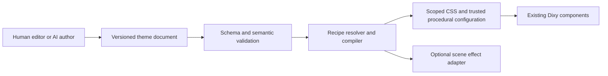

# Theme engine review and AI authoring direction

Date: 2026-10-22. Status: architecture review and proposal; no runtime implementation changed.

This document records the pre-implementation baseline. The subsequently implemented first slice is documented in [THEME_ENGINE.md](THEME_ENGINE.md): shared schema/compiler/recipes, portable six-skin defaults and parameter consistency. Broader composition, procedural parameters, editor/import UX and AI remain future work.

## Decision

Keep HTML/React components with CSS and procedural SVG as the core rendering path. The five unbuilt visual directions can use this path for their component surfaces. Add reusable, typed material/frame recipes and a portable authoring document before adding an AI generator. Reserve Canvas 2D for an explicit particle feature and WebGL for a demonstrated moving-light/refraction effect. Three.js is outside the current 2D scope; WebGPU/WGSL is not needed for this phase.

We currently have a useful runtime for six authored skins, rather than a complete parameterized theme authoring engine. Another hand-authored pack is possible now. A model cannot yet describe a new material/frame system as portable data without a developer writing CSS or React geometry.

## Reviewed inventory and evidence

Reviewed source contracts, generator/recipes, preset parser/export, lazy loading, six live desktop skins, and five unbuilt visual directions. The newest generation folder contains four boards: Ocean Depths, Candy Clay, Art Deco and Y2K Titanium. Material Light from the preceding set is included as the fifth unbuilt direction. The older Y2K board is an earlier variant, not an additional distinct theme.

Source evidence:

- `packages/tokens/src/skins.ts`: SkinDefinition v1 carries six defaults: accent, neutral, radius, density, material and shape.
- `packages/themes/src/authoring.ts`: defineSkin validates/copies/freezes that metadata; it does not validate or compile material, frame, texture or effect recipes.
- `packages/themes/src/manifests.ts`, `scripts/generate-skins.mjs`, `scripts/skin-details.mjs`: visual identity is largely authored CSS strings, frame-specific dispatch, literal dimensions/colors and bespoke React geometry.
- `apps/docs/src/lib/theme-playground.ts`: reference appearance, heading/body font, border and depth are applied from catalog metadata; the generated React wrapper includes them, but the compact skin definition alone does not contain them.
- `apps/docs/src/lib/theme-skin-catalogue.ts`: installed CSS loaders are explicitly listed; definitions, renderers, export symbols and CSS loading have separate mappings.
- `packages/react/src/theme/theme.tsx`: inheritance, portal scope, accessibility reductions and independently imported decoration already exist. Decoration parts are theme/card/dialog/switch-thumb; Button content belongs to consumers.

Fresh in-app observations are saved under `output/in-app-browser/theme-engine-review-2026-10-22/`. All six Overview scenes contain no canvas or image elements and render their existing decoration in code. This is structural evidence, not a performance profile.

A concrete parameter gap: in Studio Hardware, selecting Radius → Square produces data-radius=none and a 0px button radius, while cards retain 16px radius. The authored recipe fixes card radius at 16px. Either make that value resolve from the geometry model or declare a recipe constraint in the editor; silently ignoring the control is unsuitable for AI-generated output. Flat relief correctly removed the tested card and switch-well shadows in this focused observation; it was not identified as a failure.

## Current six skins

| Skin            | Current rendering is appropriate                                         | Parameters worth extracting from authored code                                                                                                                                               |
| --------------- | ------------------------------------------------------------------------ | -------------------------------------------------------------------------------------------------------------------------------------------------------------------------------------------- |
| Living Forest   | CSS surfaces, SVG leaves/vines/veins, SVG paper noise, optional CSS sway | Frame thickness/inset, branch curvature, leaf size/density/palette, vein contrast, seed, sway amplitude; keep detail outside content/focus areas                                             |
| Retro OS        | CSS hard edges, pixel bevels, segmented tracks and small frame inlay     | Border weight, shadow offset, pixel/bevel size, track segmentation; no fake window bar or controls                                                                                           |
| Winamp Signal   | CSS metal/LCD materials, SVG screws/meters, CSS meter motion             | Rail width, bevel, brushed grain, segment pitch, glow strength and hardware spacing; actual audio reactivity must be explicitly supplied by an app                                           |
| Studio Hardware | CSS ceramic/enamel/steel gradients, SVG screws/engraving                 | Light direction, enamel highlight, metal highlight width, inset depth, dial texture; fix geometry override consistency                                                                       |
| Prism Glass     | CSS tinted surfaces and luminous edges, SVG atmospheric light            | Tint/transmission approximation, edge highlight, opacity, background light palette/position/softness; keep an opaque readable fallback                                                       |
| Tactile Atelier | CSS enamel/brass, SVG walnut paths, paper noise and linen                | Material per surface role, grain scale/direction/contrast, stitch pitch/inset, brass highlight, enamel depth; allow a leather sidebar with paper content through deliberate role assignments |

These do not need a graphics engine to remain recognizable. Their next improvement is extracting coherent controls from hard-coded recipes and testing their combinations. GPU rendering would not fix inconsistent radius overrides, missing font defaults or a nonportable schema.

## The five unbuilt directions

| Direction      | CSS/SVG implementation                                                                      | Additional primitive or parameter                                                                | Optional enhancement                                                                                                                 |
| -------------- | ------------------------------------------------------------------------------------------- | ------------------------------------------------------------------------------------------------ | ------------------------------------------------------------------------------------------------------------------------------------ |
| Ocean Depths   | Sea-glass gradients, pearl controls, procedural coral paths, still caustic patterns         | Coral branching recipe; caustic pattern scale/intensity; pearl highlight and glass edge controls | Canvas bubbles if a particle scene is requested; one WebGL caustics layer if convincing continuously moving water light is important |
| Candy Clay     | Layered shadows, soft squircle geometry, matte grain, glossy bead gradients                 | Clay surface recipe, corner profile, extrusion, contact shadow and squash/press response         | Small CSS/SVG motion; no GPU requirement                                                                                             |
| Art Deco       | SVG line/fan/stepped frame geometry, metal gradients, lacquer surfaces                      | Stepped frame/chamfer vocabulary, brass inlay width, engraving density, metallic highlight       | Restrained highlight animation; no particle or GPU requirement                                                                       |
| Y2K Titanium   | CSS brushed metal/chrome approximations, SVG chamfers/perforations, cyan enamel/light pipes | Chamfered frame recipe, perforation pitch, specular bands, inset panel roles                     | WebGL only for a deliberate live liquid-metal/reflection scene; the component skin can remain CSS/SVG                                |
| Material Light | Layered CSS surfaces, inset/rim highlights and soft shadows; optional SVG grain             | Light ceramic/frosted recipes and consistent lighting/elevation                                  | No particle or GPU requirement                                                                                                       |

Generated boards also contain illustrative reef scenery, clay sculptures, metallic sculptures and a mascot. Those are optional page/example artwork, not mandatory additions to Button, Card or other core component content. Matching the material language is feasible; literally reproducing every painted detail from a raster board requires additional procedural art work. An extra rendering library does not provide that art automatically.

## Missing authoring vocabulary

Expose a small understandable set of controls with optional advanced parameters, derived from a typed recipe schema rather than a giant flat property bag.

| Group               | Proposed parameters and responsibilities                                                                                                                             |
| ------------------- | -------------------------------------------------------------------------------------------------------------------------------------------------------------------- |
| Foundations         | Semantic light/dark colors, body/heading typography, spacing, direction, focus and feedback roles                                                                    |
| Surface roles       | Canvas, panel, inset, control and floating surface assignments; featured versus dense treatment without changing component layout                                    |
| Materials           | Registered ceramic, enamel, glass, clay, paper, leather, brass/chrome/brushed-metal recipes; base tint, sheen, grain intensity/scale/direction and opacity           |
| Lighting            | Shared visual light direction, highlight width/strength, shadow offset/softness and rim lighting; these are visual approximations, not a claim of physical rendering |
| Geometry and edges  | Radius amount, corner profile, chamfer, frame thickness, inset and bevel; explicit parameter constraints and independent focus geometry                              |
| Procedural patterns | Registered vines, coral, stitching, engraved fans, perforation and noise generators; bounded numeric parameters and deterministic seeds                              |
| States              | Surface treatments for real hover, pressed, selected, disabled, loading, invalid and focus states using existing part/state hooks                                    |
| Motion              | Finite interaction response; separate opt-in ambient motion with bounded speed/amplitude; reduced motion always constrains it                                        |
| Effects             | Registered effect ID/version, scene placement, parameters, capability requirements, cost limits and still fallback                                                   |

A theme may map the same material to many component parts or assign different materials to deliberate surface roles. It cannot change labels, insert icons, invent controls, replace semantics, suppress focus, resize hit targets or declare fake selected/loading states.

Keep geometry, border thickness and content spacing distinct. A thick decorative frame must not consume editable text space or clip focus. A bevel or stitched outline is paint; it does not become another interactive control.

## Architecture to build

Use one normalized resolved theme for the editor preview, code export, CSS emission and generated controls. Move portable typography, border/depth and visual defaults out of docs-only assembly into this shared model. Keep recommended appearance separate from a consumer's chosen appearance; a theme should not unexpectedly force dark mode on the application.

The full authoring document should have its own schema version, namespaced ID, revision, engine/recipe compatibility, foundations, surface-role assignments, material/frame selections, scoped state recipes and optional effects. Keep these distinct from the existing compact SkinDefinition version and saved playground preset version. Add migrations/adapters so current definition v1 and preset v1/v2 consumers retain their behavior. Future richer presets require an explicit schema evolution.

The compiler can initially live in the existing themes authoring entry. Emit the current compact definition plus static scoped CSS and registered procedural configuration; the consumer need not ship the compiler, validator, editor or model client. Keep the existing independently imported CSS and renderer paths. Replace duplicated installed-skin mappings with a generated registry that still gives the bundler explicit lazy imports. User-authored data artifacts can be validated and registered locally; importing an unknown ID must never trigger arbitrary module/code fetching.

Keep a developer extension path for new trusted recipes. AI can create distinct compositions inside the supported material/geometry/pattern vocabulary. A genuinely new rendering algorithm requires a reviewed extension or a carefully bounded vector/pattern grammar; arbitrary generated JSX/SVG markup/GLSL should not run through a shared preset importer. Do not promise unlimited visual invention from six preset IDs or a finite recipe vocabulary.

Export ordinary design tokens in [DTCG format](https://www.designtokens.org/tr/2025.10/format/) where appropriate. Keep essential Dixy material/frame/effect semantics in a companion documented theme schema rather than relying on generic token extensions to describe an entire renderer. The DTCG report is an interoperability format, not a complete skin language or a W3C Standard.

## Renderer and dependency choices

Use CSS for gradients, shadows, bevels, layers, outlines, state styling and finite transitions. Use procedural SVG for scalable frames, organic paths, engraving, masks and bounded texture filters. [SVG turbulence](https://developer.mozilla.org/en-US/docs/Web/SVG/Reference/Element/feTurbulence) can synthesize noise textures; existing Forest and Atelier already use it. CSS/SVG can still be expensive with large filters or excessive nodes, so the absence of WebGL does not establish good performance.

Particles describe an effect, not a required rendering technology. A few expressive particles can be CSS/SVG. Start a more populated ambient particle scene with an independently imported [Canvas 2D](https://developer.mozilla.org/en-US/docs/Web/API/Canvas_API) adapter. Use data arrays/refs and an imperative loop, not React state updates for every particle/frame. Choose a GPU backend only after comparing the actual density, effects and target devices; there is no universal particle-count threshold.

For moving water light, live refraction or deliberately complex reflections, trial one optional 2D WebGL layer behind a scene. [WebGL shaders use GLSL](https://developer.mozilla.org/en-US/docs/Web/API/WebGL_API/Tutorial/Adding_2D_content_to_a_WebGL_context). [WGSL belongs to WebGPU](https://developer.mozilla.org/en-US/docs/Web/API/WebGPU_API), which MDN currently marks as limited availability. Do not require WebGPU or Three.js for these component themes. Reconsider a 2D engine only when a measured scene exceeds the needs of a small direct adapter; no new graphics library is justified by this review alone.

Canvas/shader rendering must remain decorative, behind semantic HTML. Avoid a context per button/card. Bound resolution, passes, particle count and filter area; share or explicitly limit scene contexts. Specify offscreen/hidden/reduced/unmount cleanup, context-loss fallback and deterministic still CSS/SVG output. Do not use bitmap sprites as the fallback. The engine policy constrains effects; theme data cannot raise a parent's reductions or budget limits. The existing 20-second editor preview is useful, but does not provide runtime effect scheduling for arbitrary apps.

## AI authoring

Place the model integration in an optional authoring service/tool, outside the core React runtime. It can use a hosted provider or a local model endpoint through the same adapter. Consumers render a saved artifact without making a model call. Credentials stay with the authoring host/service; generated theme files contain none.

The proposed flow is: brief/reference style → schema-constrained theme proposal → validation/repair → deterministic compile → live multi-state preview → user edits and acceptance → versioned artifact/export. Feed the model the actual parameter schema, recipe catalog, compatibility and component-content policy. Return field-level diagnostics and request a bounded patch instead of regenerating unrelated settings. Preserve accepted settings, history, resolved output and provenance.

Use a JSON Schema-compatible validator at import/authoring boundaries. [Closed object schemas](https://json-schema.org/understanding-json-schema/reference/object) can reject unknown executable fields; use bounds, enums, known recipe IDs and structural limits. Model structured output alone is insufficient: also validate references, cycles, token types, state coverage, light/dark text/focus contrast, geometry/spacing bounds and complexity limits. Evaluate actual composited states in the existing Overview, Player, Email, States and component gallery. Test previews in isolation before applying a novel compiled artifact to the editor shell.

[Ajv](https://ajv.js.org/json-schema.html) is a suitable authoring/compiler dependency if JSON Schema is the source of truth. Its [standalone validator generation](https://ajv.js.org/standalone.html) allows build-time compilation of the engine-owned schema without shipping the Ajv compiler in ordinary consumers. Use the appropriate 2020-12 validator class if that dialect is chosen; do not assume the default export uses it. Derive TypeScript types and editor control metadata from the same schema/recipe definitions. Retain existing CSS motion and optional Motion integrations. No additional animation library, particle library or 3D stack is recommended until there is a concrete effect to implement and compare.

For the first AI version, have it compose semantic palettes plus the new materials/frames/pattern parameters. Do not let it rewrite Base UI components, invent application actions or alter component content. If a requested visual falls outside supported recipes, report that clearly and propose a reviewed extension. The model is an author of proposals; the deterministic compiler and component contracts decide the runnable result.

## Simplify or retire

- Replace per-theme hard-coded dimensions with schema-backed values or documented locks. The Hardware radius observation is the first regression to address.
- Resolve overlapping depth/relief and material/finish controls into one canonical model with compatibility adapters; preserve genuinely different geometry and finish axes.
- Generate authoring controls, import validation and documentation metadata from the same recipe contracts.
- Consolidate registry mappings and shared ornament parameter types without making the core depend on a theme pack.
- Preserve the recent removal of injected button symbols and fake window controls in every future recipe/model prompt.
- Keep model SDKs, compilers, particle engines and GPU backends outside the default component runtime.

## Recommended order

1. Fix parameter precedence and portable defaults; formalize surface/content constraints. Add focused regression evidence for settings advertised by the editor.
2. Build the authoring document, typed recipe registry, shared resolver/compiler and migrations. Use JSON to reproduce the existing six packs before expanding the graphics stack.
3. Add clay, sea-glass/coral, stepped brass and chamfered titanium recipes. Material Light can reuse ceramic/frosted primitives. Build all five still variants through existing components and scenes.
4. Add fork/edit/register/export for user-created documents, with per-field validation, reference handling and versioned artifacts.
5. Add the optional AI authoring adapter against that same schema and evaluation set.
6. Separately trial Canvas bubbles/particles and an Ocean WebGL caustics layer. Keep or drop them based on target-device evidence and preference/fallback behavior.

This pass was source/image/live-preview review and documentation only. No dependency, shader, particle engine, model integration or runtime feature was added. Implementation checks were not rerun because no implementation changed. Mobile, hardware profiling, OS preference emulation, full accessibility/AT/zoom and additional framework fixtures remain outside this review, consistent with the user's earlier deferrals. The latest implementation checks are recorded separately in BUILD_LOG.md.
